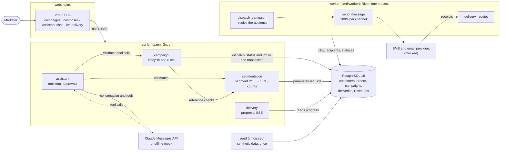

# Architecture

- **Composing:** the SPA calls the API. Campaign rules live in `campaign`; segments compile to
  SQL in `segmentation`.
- **AI:** Claude only proposes tool calls. Go validates each one and runs it through the same
  services; a dispatch waits for a person's approval in the app.
- **Sending:** a dispatch commits the campaign's status and its River job together. The single
  worker resolves the recipients, sends through the rate-limited providers and records receipts;
  the campaign page follows progress over SSE.
